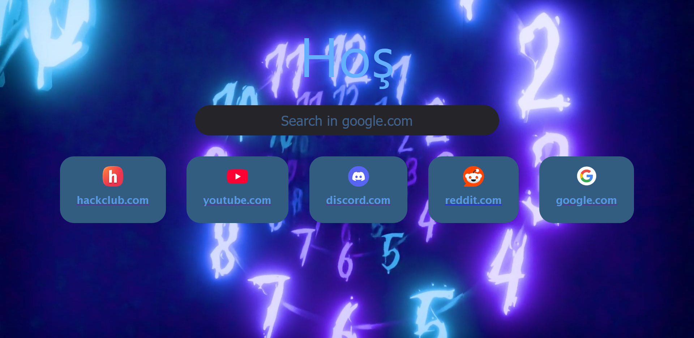

# New Tab Project

Essentially, this is a browser start page built using HTML, CSS, and JavaScript.



## Requirements

To run this project, you will need a web browser.

You can try a demo on [the GitHub Pages website](https://k0l1-hub.github.io/New-Tab-Project/), although it won't function as your browser's actual new tab page.

First, you can clone this repository using:

```bash
git clone https://github.com/k0l1-hub/New-Tab-Project.git
```

You can run this command in Git Bash. Alternatively, you can click the green **<> Code** button above and download the repository as a `.zip` file.

The setup process depends on which browser you are using.

**Firefox**

1. Click the three dots in the top-right corner of the browser.
2. Go to **Settings** and open **Home**.
3. Scroll down and find the Firefox Home customization options.
4. Under **New Windows and Tabs**, change the default setting to a custom URL.
5. Select **Choose a specific site**.
6. In the address field, enter the path to your `index.html` file or use this URL: https://k0l1-hub.github.io/New-Tab-Project/
7. Click **Add address**.
8. You can now close this page.

**Microsoft Edge**

1. Click the three dots in the top-right corner of the browser.
2. Go to **Settings**.
3. Select **Start, home, and new tab page**.
4. Find the option to open a custom site.
5. Enter the path to your `index.html` file or use this URL: https://k0l1-hub.github.io/New-Tab-Project/
6. Click **Add address**.
7. You can now close this page.

### Google Chrome

Chrome does not allow you to set a custom new tab page through its default settings. You will need an extension to do this.

## Customization

To customize the project, open the JavaScript file and find the `config` block at the top.

You can change the available options according to your preferences.

- **Background:** Change the `background` option to the path of your video or image, or simply use a color. (REMEMBER TO PUT IT BETWEEN DOUBLE QUOTES.)

- **Videos and Images:** You can enable or disable videos by setting the `video` option to `true` or `false`. If you want to use an image, remember to include `url('your-image-path')`.

- **File Paths:** Always use forward slashes (`/`) instead of backslashes (`\`) when specifying file paths.

- **Domains:** Replace the existing list of domains with the websites you want to display.

- **Title Movement:** If you don't like the animation, you can disable it by entering something between the quotation marks (`""`). Leave it empty to enable the animation.

- **Search Engine:** By default, the project uses Google (`google.com`), but it also supports DuckDuckGo (`duckduckgo.com`).

- **Welcome:** I wouldn't recommend changing this list, but you can add another language or remove existing ones if you want.

For the background color, I recommend `#1B2845`.

## AI Usage

AI is used only to help identify potential errors, including grammatical mistakes. All code is written by humans.

## Contributions

Feel free to suggest improvements or contribute to the project!

## License

This project is licensed under the MIT License. Anyone is free to use, modify, distribute, and even sell software incorporating this project, subject to the license terms.

## Attribution

Attribution is greatly appreciated. If you use this project, mentioning the original author's name would be wonderful!

## Future Plans

- Add widgets.
- Develop a Chrome extension.
- Make the title animation smoother.

:D
